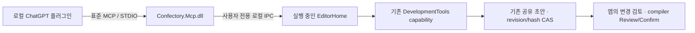

# Confectory 개인 개발용 MCP 플러그인

ChatGPT 앱의 플러그인에서 Confectory를 표준 도구로 발견·호출하기 위한 개발 패키지다. 새 편집기·제안 저장소·일괄 작업 시스템을 만들지 않는다. 이미 있는 `DevelopmentTools`의 정의와 `workspace_list/read/inspect/stage/create/changes`를 변환해 전달한다. 실제 개인 플러그인 설치·앱 연결은 별도 사용자 확인 단계이며, 공개 배포된 Confectory 플러그인이나 설치 링크를 뜻하지 않는다.

## 현재 구현



어댑터는 독립적으로 프로젝트 파일을 열지 않는다. 앱이 열어 둔 프로젝트, 동일한 `local-user/editor` draft와 선택한 소유 노드 capability를 그대로 쓴다. 이 때문에 사람과 플러그인의 초안이 실제로 공유되고, 다른 편집 뒤 오래된 revision/hash는 기존 엔진에서 거부된다. 노드 선택은 연결 준비 시 고정되며 이후 inspector 선택을 자동으로 따라가지 않는다.

프로젝트 범위는 기존 namespace 소유 소스 도구를 제공한다. Blueprint 노드 본문은 앱에서 C# 노드를 선택하고 **선택한 Blueprint 노드** 범위로 준비한다. 노드 capability는 해당 소스와 graph/계약의 기존 관찰 pin을 사용한다. 새로운 소스·권한·제안 모델을 별도로 정의하지 않는다. 이 범위 제한은 Confectory MCP 도구에 적용되며 ChatGPT 자체나 다른 플러그인의 권한을 변경하지 않는다.

첫 연결은 읽기 전용이다. 앱에서 읽기 전용을 해제하고 새로 준비한 경우에만 기존 초안 편집 도구가 도구 목록에 나온다. `workspace_stage/create`는 최종 파일을 쓰지 않는다. Confirm·빌드·실행·shell·임의 파일 경로 도구는 없다. 플러그인 설치만으로 앱의 연결 범위를 준비하거나 기존 초안을 승인하지 않는다.

## 실제 패키지와 빌드

소스는 `plugins/confectory/`다. portable `plugin.json`, `mcp.json`, 온보딩 `skills/setup/SKILL.md`와 marketplace **예시**가 있다. `.agents/plugins/marketplace.json`이나 사용자 설정에는 자동 등록하지 않는다.

이미 설치된 .NET 10 SDK로 다음을 실행하면 된다. SDK·런타임을 설치하는 명령은 포함하지 않는다.

```text
dotnet build targets/mcp-host/Confectory.Mcp.csproj -c Release
python3 tools/package_mcp_plugin.py --output /원하는/경로/Confectory-plugin-dev.zip
```

ZIP은 `confectory/plugin.json`, `mcp.json`, `skills/`와 실제 빌드된 `server/Confectory.Mcp.dll`, deps/runtimeconfig 및 SHA-256 영수증을 포함한다. `mcp.json`의 실제 실행은 플러그인 root를 cwd로 삼아 `dotnet ./server/Confectory.Mcp.dll`을 시작하는 STDIO다. 연결 창은 공통 desktop WebUI와 Windows 기본 embedded 화면에 연결돼 있다. Linux 검사는 기존 `CONFECTORY_UI=web` 실행 표면을 사용한다. 별도 Linux native tree에는 이 새 메뉴를 연결하지 않았다.

사용자 앱 환경의 PATH에서 .NET 10 `dotnet` 런타임이 실행 가능해야 한다. Confectory가 자체 런타임을 포함해 실행된다는 사실만으로 이를 가정하지 않는다. 없으면 자동 설치하지 않고 기존 런타임/앱 환경 확인에서 멈춘다.

## 사용자가 직접 시험할 절차

1. ZIP을 풀고, **로컬 플러그인 소스를 지원하는 ChatGPT 데스크톱 앱**에 개인 개발 패키지로 추가한다. 로컬 소스의 제공 여부는 앱 표면/버전에 따라 다르다. `marketplace.example.json`은 사용자가 선택한 실제 플러그인 위치를 가리키도록 기존 개인 목록에 병합할 때 참고하는 자료다. 현재 작업은 설치·marketplace 등록·앱 재시작·공개 제출을 실행하지 않는다. 브라우저/클라우드 채팅은 사용자의 로컬 IPC에 직접 접근하지 않는다.
2. Confectory에서 프로젝트를 열고 **메뉴 → ChatGPT 플러그인 연결**을 연다. 노드만 공유하려면 먼저 **기능 Blueprint → C# 노드 → 설명·연결**로 노드를 선택한 뒤 연결 창을 다시 연다. 범위를 고르고 **읽기 전용으로 연결**을 유지한 채 **연결 준비**를 누른다. Agent 연결 대화상자에도 이 화면으로 이동하는 버튼이 있다. 프로젝트가 없으면 먼저 열도록 안내한다.
3. 플러그인의 설정 절차에서 `confectory_instances`로 준비된 엔진을 조회하고, 표시된 `instanceId`로 `confectory_connect`한 뒤 `confectory_status`의 프로젝트·노드·읽기 전용 상태를 확인한다. 여러 엔진이면 사용자에게 선택을 받는다. `workspace_list/read` 결과가 앱의 선택 범위와 같아야 한다. 편집 시험은 앱에서 연결을 닫고 읽기 전용을 해제해 새 범위로 준비한 뒤 진행한다. 도구의 변경은 앱의 기존 **변경 검토 → Review/Confirm** 전까지 최종 파일을 바꾸면 안 된다.

수동 Codex CLI 설정을 필수로 요구하는 구성은 아니다. 개인/개발용 local 또는 repository marketplace와 온보딩 경로는 [공식 플러그인 패키징 문서](https://developers.openai.com/plugins/build/plugins)를 따른다. 공개 desktop-only 디렉터리 제출 조건은 별도 [제출 문서](https://developers.openai.com/plugins/deploy/desktop-only)의 범위다. 개인 개발이 공개 제출과 같은 절차라는 의미는 아니다. 실제 ChatGPT 앱의 설치/연결 호환성은 이 저장소 검사만으로 검증됐다고 표시하지 않는다.

## 연결 상태와 실패

| 상태 | 확인할 내용 |
| --- | --- |
| `engine_not_running` | 앱에서 프로젝트를 열고 연결 준비를 눌렀는지 확인 |
| `instance_not_found` | 엔진을 다시 조회하고 현재 표시된 instanceId로 선택 |
| `engine_unavailable` | 닫힘·응답 지연·연결 거부 상태. 앱 상태 확인 후 명시적으로 재연결 |
| `read_only` | 앱의 읽기 전용 범위. 편집을 원하면 사용자가 연결을 닫고 다시 준비 |
| `scope_changed` / `source_changed` / `operation_refused` | 프로젝트·노드 변경, capability pin, 허용 도구와 입력 확인. 오래된 입력을 강제로 재적용하지 않음 |
| `invalid_engine_response` | 응답 형식/예산을 검증하지 못함. 앱에서 새 연결 준비 |
| `write_outcome_unknown` | 편집 완료 여부 불명. 자동 재전송/rollback 주장 없이 기존 변경 목록 확인 |

연결 정보는 사용자 전용 임시 discovery JSON과 IPC 주소다. 계정 토큰·Codex 로그인 정보·영구 접근 credential을 만들거나 저장하지 않는다. Windows는 CurrentUserOnly named pipe, Linux 계열은 private Unix socket이다. TCP 포트·터널·방화벽·CSP 설정을 추가하지 않는다. 프로젝트 전환, 연결 닫기와 정상 앱 종료는 기존 capability를 닫고 discovery를 제거한다. 비정상 종료 후 남은 오래된 descriptor는 연결 성공으로 취급하지 않는다. 앱 재시작 뒤 연결 권한이나 편집 요청을 자동 복구/재실행하지 않는다.

STDIO는 UTF-8 newline JSON-RPC, 최대 8 MiB frame, 최대 8 pending/2 concurrent 요청, 256개 ID 및 bounded 완료 응답 cache다. 앱 IPC frame은 4 MiB이며 기존 DevelopmentTools의 입력/출력/호출 예산이 그대로 적용된다. 연결 adapter가 원본 파일을 쪼개거나 노드 크기 계약을 바꾸지 않는다. 취소는 대기와 늦은 답변을 막지만 이미 승인된 초안 편집을 되돌리지 않는다. 같은 요청 ID의 같은 입력은 중복 편집하지 않고 다른 입력은 거부한다.

## null.schema 오류와 검증 범위

기존 Agent 선택 화면은 `setup?.connection === selected?.id`에서 양쪽이 빈 경우 `undefined === undefined`로 통과한 뒤 `setup.schema`를 읽었다. 실제 빈 Home 화면의 갱신 콜백에서 `Cannot read properties of null (reading 'schema')`를 재현했다. 선택된 연결과 실제 setup이 함께 존재할 때만 갱신하도록 고쳤고, 뒤로 가기·닫힌 DOM·저장 후 재진입도 검사한다. 이 오류 자체를 인증·Codex transport 실패라고 해석하지 않는다.

로컬 프로토콜 검사는 실제 managed STDIO 어댑터와 명확히 표시한 임시 Unix IPC fixture를 사용한다. 실제 엔진 검사는 ordinary EditorHome, 실제 DevelopmentTools 및 Chromium에서 공유 초안·노드 source pin/hash CAS·중복 편집·미제출 입력·사용자 compiler Review/Confirm·프로젝트 전환·cold를 확인한다. 실제 ChatGPT 앱 설치/연결과 Windows 장치의 named pipe는 별도 사용자 환경 검사다. Android/브라우저 호스트의 로컬 bridge는 제공하지 않는다. 최종 실행 메서드·소스·로그·패키지 해시는 검증 기록에 남긴다.

잘못된 IPC frame이나 연결 중단은 해당 클라이언트 연결만 닫는다. 과도한 frame 하나가 앱에서 준비한 연결 범위 전체를 종료하던 문제를 실제 엔진에서 재현한 뒤 수정했다. 앱을 다시 시작하면 연결 창의 표시와 배치는 복원하되 연결 권한은 복원하지 않고 읽기 전용 상태로 다시 준비하도록 한다.

최종 소스는 `25c2c1bfbf567eff58fc02ef6bf025aeee830622`이며 최종 검사 11개가 통과했다(실패 0, 건너뜀 0, 최대 동시 실행 2개). 정확한 메서드별 결과와 소스·로그·패키지 해시는 [검증 기록](validation/mcp-plugin.json)에 둔다. `Confectory-plugin-dev.zip`은 이 소스에서 빌드한 DLL을 포함하며 SHA-256은 `c51acf8e8946ffe729dce59a362953ae803505b62da0ae5fa22abc9b872fa401`이다. 실제 ChatGPT 앱 설치나 연결 완료를 뜻하지 않는다.

별도로 진행하던 v508 분기 종료 UI는 미완료 상태로 보존돼 있다. stash `692d393ff7da35ed905264fe5b3a0eff1fef4b95`와 `Confectory-v508-branch-ends-WIP.bundle`에 원래 수정 및 미추적 파일을 담았으며, 이 MCP 변경에는 포함하지 않았다. 번들의 선행 커밋은 `b05c6ed228a32d7bed181ac80b66a10f9fbb0d32`, SHA-256은 `c98dc4ec0809b457344b7c58413e596790717230f19e025d5c74311b968e334e`다. 후속 작업에서 보존된 수정과 현재 리소스 선언을 함께 검토해 복원해야 한다.
