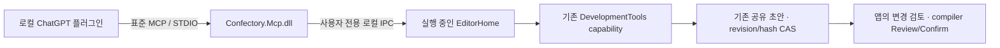

# Confectory 개인 개발용 MCP 플러그인

ChatGPT 앱의 플러그인에서 Confectory를 표준 도구로 발견·호출하기 위한 개발 패키지다. 새 편집기·제안 저장소·일괄 작업 시스템을 만들지 않는다. 이미 있는 `DevelopmentTools`의 정의와 `workspace_list/read/inspect/stage/create/changes`를 변환해 전달한다. 실제 개인 플러그인 설치·앱 연결은 별도 사용자 확인 단계이며, 공개 배포된 Confectory 플러그인이나 설치 링크를 뜻하지 않는다.

## 현재 구현



어댑터는 독립적으로 프로젝트 파일을 열지 않는다. 앱이 열어 둔 프로젝트, 동일한 `local-user/editor` draft와 선택한 소유 노드 capability를 그대로 쓴다. 이 때문에 사람과 플러그인의 초안이 실제로 공유되고, 다른 편집 뒤 오래된 revision/hash는 기존 엔진에서 거부된다. 노드 선택은 연결 준비 시 고정되며 이후 inspector 선택을 자동으로 따라가지 않는다.

프로젝트 범위는 기존 namespace 소유 소스 도구를 제공한다. Blueprint 노드 본문은 앱에서 C# 노드를 선택하고 **선택한 Blueprint 노드** 범위로 준비한다. 노드 capability는 해당 소스와 graph/계약의 기존 관찰 pin을 사용한다. 새로운 소스·권한·제안 모델을 별도로 정의하지 않는다. 이 범위 제한은 Confectory MCP 도구에 적용되며 ChatGPT 자체나 다른 플러그인의 권한을 변경하지 않는다.

첫 연결은 읽기 전용이다. 앱에서 읽기 전용을 해제하고 새로 준비한 경우에만 기존 초안 편집 도구가 도구 목록에 나온다. `workspace_stage/create`는 최종 파일을 쓰지 않는다. Confirm·빌드·실행·shell·임의 파일 경로 도구는 없다. 플러그인 설치만으로 앱의 연결 범위를 준비하거나 기존 초안을 승인하지 않는다.

## 개발용 marketplace 소스와 빌드

플러그인 소스는 `plugins/confectory/`, marketplace 원본 예시는 `plugins/marketplace.example.json`, 배포 루트 안내는 `plugins/MARKETPLACE.md`다. 저장소의 플러그인 소스에는 생성된 서버 DLL이 없다. 이 저장소 Git URL만 등록하면 실행 가능한 플러그인이 생긴다고 안내하지 않는다.

이미 설치된 .NET 10 SDK로 다음을 실행하면 된다. SDK·런타임을 설치하는 명령은 포함하지 않는다.

```text
dotnet build targets/mcp-host/Confectory.Mcp.csproj -c Release
python3 tools/package_mcp_plugin.py --output /원하는/경로/Confectory-marketplace-dev-0.1.1.zip
```

ZIP은 **개발용 소스를 옮기는 압축 파일**이다. 사용자 앱에 ZIP을 직접 가져와 설치하는 형식으로 안내하지 않는다. 압축을 풀면 다음 루트 하나가 생긴다.

```text
confectory-development/
  .agents/plugins/marketplace.json
  plugins/confectory/
    plugin.json
    mcp.json
    skills/setup/SKILL.md
    server/Confectory.Mcp.dll
    server/Confectory.Mcp.deps.json
    server/Confectory.Mcp.runtimeconfig.json
    README.md
  package-receipt.json
  README.md
```

marketplace의 `source.path: ./plugins/confectory`는 `confectory-development/` 기준이다. `.agents/plugins/` 기준으로 해석하지 않는다. packaging 도구는 이 완성된 소스 안에만 catalog를 생성한다. 현재 저장소의 실제 `.agents/plugins/marketplace.json`, 사용자 설정과 설치 cache는 변경하지 않는다. 전체 트리를 함께 옮기면 상대 경로가 유지된다. 플러그인 root의 `mcp.json`은 `${PLUGIN_ROOT}`를 cwd로 사용해 `dotnet ./server/Confectory.Mcp.dll`을 시작한다.

사용자 앱을 실행하는 환경에서 `dotnet --list-runtimes`를 확인한다. 명령을 찾지 못하면 그 환경의 PATH/기존 런타임 위치를 확인해야 한다. 명령은 실행되지만 `Microsoft.NETCore.App 10.x.x`가 없으면 필요한 런타임이 없다. 최신 major 런타임만 있는 경우도 기본 정책상 충분하지 않다. 이 문제를 계정 인증이나 프로젝트 연결 실패로 표시하지 않는다. SDK는 빌드용이며 사용자 호스트에는 해당 .NET 10 런타임이 필요하다. Confectory의 자체 포함 런타임만으로 별도 플러그인 호스트의 PATH를 가정하지 않고, 자동 설치·PATH 변경을 실행하지 않는다.

## 소스 등록, 앱 설치, 엔진 연결

**소스 등록**이 먼저다. [공식 패키징 문서](https://developers.openai.com/plugins/build/plugins)는 repo 또는 개인 marketplace 파일을 설명한다. 사용자가 기존 루트를 선택한 뒤 catalog 항목과 실제 빌드된 플러그인 위치를 맞춰야 한다. 기존 catalog는 항목을 병합하고 전체를 덮어쓰지 않는다. 다른 루트에 옮길 때에는 그 루트 안의 실제 플러그인 위치에 맞춰 상대 경로를 조정한다.

이미 지원되는 로컬 CLI가 있는 개발 환경에서는 [공식 개발자 명령](https://learn.chatgpt.com/docs/developer-commands)에 따른 다음 등록 경로도 있다. 대상은 ZIP이나 플러그인 하위 폴더가 아닌 **marketplace 루트**다.

```text
codex plugin marketplace add "/absolute/path/to/confectory-development"
```

위 명령은 사용자 설정을 바꾸는 소스 등록 작업이며 이번 구현·검증에서는 실행하지 않았다. `config.toml`이나 개별 MCP 서버를 수동 편집하도록 요구하는 구성은 아니다. CLI가 없다고 자동 설치하거나, 확인되지 않은 앱의 ZIP 가져오기/Git URL 입력 버튼을 안내하지 않는다. 개인 marketplace 파일을 쓰는 문서상 대안도 있지만, 실제 파일 변경 역시 사용자 환경에서 별도로 확인해야 한다. 관리자용 Import marketplace는 개인 계정의 등록 절차로 적용하지 않는다.

**앱 설치**는 그다음이다. [공식 Plugins 안내](https://learn.chatgpt.com/docs/plugins)와 패키징 문서의 desktop 흐름은 등록 후 앱을 재시작하고, Plugins에서 해당 소스를 선택해 상세 화면의 `+`로 설치한 뒤 새 채팅을 시작하는 것이다. 이는 문서로 확인한 절차다. 사용자의 앱에서 해당 소스가 나타나는지, 실제 설치 cache와 온보딩이 동작하는지는 아직 직접 검증하지 않았다. 단순 압축 해제나 저장소 push를 설치 완료로 보지 않는다.

**엔진 연결**은 설치 후 기존 온보딩으로 진행한다. Confectory에서 프로젝트를 열고 **메뉴 → ChatGPT 플러그인 연결**에서 정확한 범위를 골라 읽기 전용으로 준비한다. 노드만 공유하려면 먼저 Blueprint의 C# 노드를 선택한다. `confectory_instances`로 조회한 실제 instanceId로 `confectory_connect`한 뒤 `confectory_status`에서 프로젝트·노드·읽기 전용 상태를 확인한다. 여러 엔진이면 사용자에게 선택을 받는다. 편집은 사용자가 앱에서 범위를 다시 준비한 뒤 기존 변경 검토·Review/Confirm을 거친다. 이 엔진 흐름과 실제 STDIO 명령은 로컬에서 검증했고, 실제 ChatGPT 앱과 연결한 결과는 아니다.

공통 desktop WebUI와 Windows 기본 embedded 화면에는 연결 창이 있다. Linux 검사는 기존 `CONFECTORY_UI=web` 표면을 사용하며 별도 native tree에는 이 메뉴를 연결하지 않았다. 브라우저/클라우드 세션은 사용자 로컬 IPC에 직접 접근하지 않는다.

[공개 desktop-only 제출](https://developers.openai.com/plugins/deploy/desktop-only)은 승인 파트너 대상 심사·포털 ZIP 업로드 경로다. 개인 개발 소스 등록과 구분하며, 현재 marketplace 루트를 감싼 ZIP을 심사 제출용 플러그인 ZIP으로 설명하지 않는다. 이번 작업은 사용자 앱 설치·설정 변경·계정/접근 권한 생성·공개/워크스페이스 배포 등록을 실행하지 않는다.

## 연결 상태와 실패

| 상태 | 확인할 내용 |
| --- | --- |
| `engine_not_running` | 앱에서 프로젝트를 열고 연결 준비를 눌렀는지 확인 |
| `instance_not_found` | 엔진을 다시 조회하고 현재 표시된 instanceId로 선택 |
| `engine_unavailable` | 닫힘·응답 지연·연결 거부 상태. 앱 상태 확인 후 명시적으로 재연결 |
| `read_only` | 앱의 읽기 전용 범위. 편집을 원하면 사용자가 연결을 닫고 다시 준비 |
| `scope_changed` / `source_changed` / `operation_refused` | 프로젝트·노드 변경, capability pin, 허용 도구와 입력 확인. 오래된 입력을 강제로 재적용하지 않음 |
| `invalid_engine_response` | 응답 형식/예산을 검증하지 못함. 앱에서 새 연결 준비 |
| `write_outcome_unknown` | 편집 완료 여부 불명. 자동 재전송/rollback 주장 없이 기존 변경 목록 확인 |

연결 정보는 사용자 전용 임시 discovery JSON과 IPC 주소다. 계정 토큰·Codex 로그인 정보·영구 접근 credential을 만들거나 저장하지 않는다. Windows는 CurrentUserOnly named pipe, Linux 계열은 private Unix socket이다. TCP 포트·터널·방화벽·CSP 설정을 추가하지 않는다. 프로젝트 전환, 연결 닫기와 정상 앱 종료는 기존 capability를 닫고 discovery를 제거한다. 비정상 종료 후 남은 오래된 descriptor는 연결 성공으로 취급하지 않는다. 앱 재시작 뒤 연결 권한이나 편집 요청을 자동 복구/재실행하지 않는다.

STDIO는 UTF-8 newline JSON-RPC, 최대 8 MiB frame, 최대 8 pending/2 concurrent 요청, 256개 ID 및 bounded 완료 응답 cache다. 앱 IPC frame은 4 MiB이며 기존 DevelopmentTools의 입력/출력/호출 예산이 그대로 적용된다. 연결 adapter가 원본 파일을 쪼개거나 노드 크기 계약을 바꾸지 않는다. 취소는 대기와 늦은 답변을 막지만 이미 승인된 초안 편집을 되돌리지 않는다. 같은 요청 ID의 같은 입력은 중복 편집하지 않고 다른 입력은 거부한다.

## null.schema 오류와 검증 범위

기존 Agent 선택 화면은 `setup?.connection === selected?.id`에서 양쪽이 빈 경우 `undefined === undefined`로 통과한 뒤 `setup.schema`를 읽었다. 실제 빈 Home 화면의 갱신 콜백에서 `Cannot read properties of null (reading 'schema')`를 재현했다. 선택된 연결과 실제 setup이 함께 존재할 때만 갱신하도록 고쳤고, 뒤로 가기·닫힌 DOM·저장 후 재진입도 검사한다. 이 오류 자체를 인증·Codex transport 실패라고 해석하지 않는다.

로컬 프로토콜 검사는 실제 managed STDIO 어댑터와 명확히 표시한 임시 Unix IPC fixture를 사용한다. 실제 엔진 검사는 ordinary EditorHome, 실제 DevelopmentTools 및 Chromium에서 공유 초안·노드 source pin/hash CAS·중복 편집·미제출 입력·사용자 compiler Review/Confirm·프로젝트 전환·cold를 확인한다. 실제 ChatGPT 앱 설치/연결과 Windows 장치의 named pipe는 별도 사용자 환경 검사다. Android/브라우저 호스트의 로컬 bridge는 제공하지 않는다. 최종 실행 메서드·소스·로그·패키지 해시는 검증 기록에 남긴다.

잘못된 IPC frame이나 연결 중단은 해당 클라이언트 연결만 닫는다. 과도한 frame 하나가 앱에서 준비한 연결 범위 전체를 종료하던 문제를 실제 엔진에서 재현한 뒤 수정했다. 앱을 다시 시작하면 연결 창의 표시와 배치는 복원하되 연결 권한은 복원하지 않고 읽기 전용 상태로 다시 준비하도록 한다.

초기 MCP 구현 소스 `25c2c1bfbf567eff58fc02ef6bf025aeee830622`의 검사 11개가 통과했다(실패 0, 건너뜀 0, 최대 동시 실행 2개). 당시 메서드·소스·로그·이전 압축 파일의 해시는 [초기 검증 기록](validation/mcp-plugin.json)에 보존한다. 그때의 `Confectory-plugin-dev.zip`은 marketplace 루트가 빠진 이전 산출물이므로 현재 등록 안내에는 사용하지 않는다. 이번 변경은 엔진·어댑터를 바꾸지 않고 개발 소스의 catalog 경로와 패키징·안내를 보완한다.

현재 개발 소스 전달 파일은 `Confectory-marketplace-dev-0.1.1.zip`이며 SHA-256은 `1dc20eb8ef68fdab20492fee7431e11c691264c749d6189922b8cf4bdafd2fa1`이다. 소스 `6fbc031`에서 catalog 경로, 전체 파일 해시, portable schema 및 실제 STDIO 명령을 확인하는 검사 1개가 통과했다. 전체 루트를 공백이 있는 경로로 옮긴 경우와 플러그인만 별도로 복사한 경우도 실행했다. 이는 실제 ChatGPT 설치 cache를 실행한 결과가 아니다. 이전 엔진 검사 11개는 다시 실행하지 않았으며 엔진·어댑터 소스와 전달한 DLL/deps/runtimeconfig의 동일성을 확인했다. [이번 패키징 검증 기록](validation/mcp-marketplace-packaging.json)에 정확한 소스·파일·로그 해시와 문서로만 확인한 단계를 남긴다.

별도로 진행하던 v508 분기 종료 UI는 미완료 상태로 보존돼 있다. stash `692d393ff7da35ed905264fe5b3a0eff1fef4b95`와 `Confectory-v508-branch-ends-WIP.bundle`에 원래 수정 및 미추적 파일을 담았으며, 이 MCP 변경에는 포함하지 않았다. 번들의 선행 커밋은 `b05c6ed228a32d7bed181ac80b66a10f9fbb0d32`, SHA-256은 `c98dc4ec0809b457344b7c58413e596790717230f19e025d5c74311b968e334e`다. 후속 작업에서 보존된 수정과 현재 리소스 선언을 함께 검토해 복원해야 한다.
