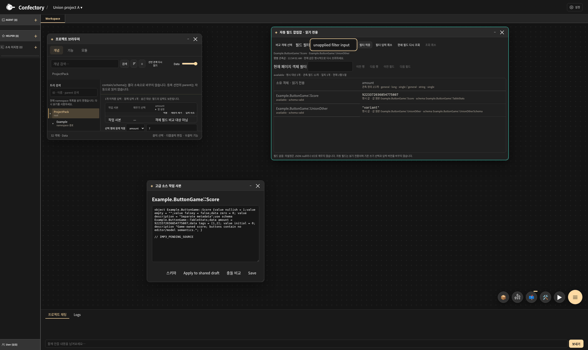
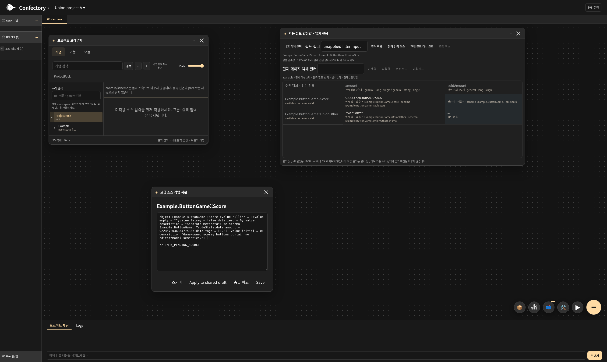

# IMP3: 명시 대상의 자동 필드 합집합

Data 브라우저·즉석 표·대상 선택창에서 명시적으로 고른 소유 객체의 실제 메타데이터와 기존 스키마 필드를 읽어 별도 읽기 전용 창에 합집합으로 표시한다. 기존 쓰기 표를 자동 구성하거나 쓰기 권한을 넓히지 않는다. 계산 열·새 산술·일반 선택 범위 확장은 [남은 IMP3](V480_REMAINING_WORK.md)에 유지한다. 전체 v480 완료를 뜻하지 않는다.

소스 기준은 `9ce77d225cc0d64928087574e872c076c3cb4a88`다. 최종 서로 다른 **9개 메서드가 통과, 실패 0, 건너뜀 0**이다. 4 CPU/16 GiB에서 gate는 최대 2개였으며, 정확한 그룹별 시간·메서드는 아래 근거에 기록한다.

소스 커밋과 최종 검사 결과는 [기계 판독 근거](validation/v480-automatic-field-union.json), 개발 중 실패를 포함한 실행 기록은 [시도 로그](validation/v480-automatic-field-union-attempts.log)를 따른다. 이전 통합 235개나 IMP1/IMP2 결과와 합산하지 않는다.

## 조회와 값의 의미

`FieldDiscovery`는 기존 `PackWorkspace`의 공유 초안을 빌려 `EditWorkspace`의 소유 목록·상태·본문·`DescribeSchema`를 읽는다. 현재 project ID와 context가 일치해야 하며 선택 ID 전부가 root의 소유 객체인지 확인한 뒤 필드를 읽는다. 등록 팩의 객체, 다른 선언 종류, 다른 프로젝트·context는 거부한다. 객체 선택창의 목록 조회는 선택하지 않은 객체의 필드를 조회하지 않는다. 기존 스키마 조회가 허용하는 스키마 메타데이터 경계를 그대로 사용한다.

합집합은 필드 ID로 결합하고 타입·cardinality가 다른 관측을 별도로 표시한다. `definedCount`는 관측한 정의 수이며, 실패한 행을 없는 정의로 세지 않는다. 데이터 경로·예약 이름을 기존 표와 같은 ID 규칙으로 구분한다. 결과의 모든 셀은 `writable:false`다. 기존 편집 함수는 여전히 쓰기 표에 명시한 객체와 열만 허용하며 발견된 필드의 최신 버전을 가져와도 그 선택을 넓힐 수 없다.

| 관측 | 표시 의미 |
|---|---|
| 정의 없는 필드 | `missing`, `defined:false`, 값 없음 |
| 선언됐으나 미설정 | `unset`, `defined:true`, 값 없음 |
| 실제 JSON null 응답 | `hasValue:true`, `valueJson:"null"` |
| 0·false·빈 문자열 | 실제 JSON을 그대로 표시 |
| 원본 없는 description | 기존 조회 API의 빈 문자열 기본값을 `default`로 표시 |
| 행 조회 실패 | `row-unavailable`, 정의·값 존재 여부 unknown |
| 객체 필드 한도로 미관측 | `unobserved-limit`, 정의·값 존재 여부 unknown |
| 값 바이트 한도 | `value-limit`, 값이 있음을 유지하고 값 본문은 생략 |

`valueJson`은 서버가 직렬화한 문자열이다. 브라우저가 숫자로 다시 파싱하지 않으므로 Int64 최댓값을 보존한다. 없는 필드·미설정·조회 실패를 null이나 0으로 채우지 않는다.

**현재 CELEM 메타데이터 문법과 기존 쓰기 API는 null 리터럴을 허용하지 않는다.** 이 변경은 문법·타입 ABI·쓰기 의미를 확장하지 않는다. 실제 null 응답을 구분하는 검사는 소유 fixture의 `DescribeSchema` 복사본이 정상 scalar 원본의 조회 응답만 null로 바꾸는 adapter로 수행한다. 제품 소스에 test switch가 없으며 CELEM null 원본을 편집·저장할 수 있다는 주장이 아니다.

## 한도와 실패

- 명시 대상 1~64개, ID 512자, 필터 256자. 객체 선택 목록은 64개씩 조회한다.
- 객체당 최대 1024개 필드를 관측한다. 기존 스키마 조회의 512행·깊이 64 한도도 유지한다. 초과 시 정의 없음으로 단정하지 않는다.
- 일치 필터를 먼저 적용한 합집합을 최대 512열로 제한하고 16열·16행씩 표시한다. 타입 표시도 최대 네 종류이며 초과를 알린다. 전체 대상의 메타데이터를 읽어 합집합을 만들되 본문 값은 현재 페이지에만 실어 보낸다.
- 값 하나 64 KiB, 페이지 값 합계 256 KiB, 직렬화 응답 1 MiB다. 응답을 줄이면 실제 반환한 행 다음부터 이어서 조회한다.
- 성공한 행은 최대 두 번의 기존 스키마 조회로 확인한다. 선택 객체·스키마의 revision/hash와 resolved view hash를 재검사하여 도중 변경된 결과를 현재 합집합으로 게시하지 않는다. 개별 파싱/조회 실패는 다른 행과 분리한다.
- 취소는 기존 WebUI cancellation token을 사용한다. 현재 메타데이터 호출 뒤와 다음 읽기 전에 협력적으로 멈춘다. 새 호출·필터 변경·대상 변경·닫기·프로젝트 전환은 이전 응답을 무시한다. 자동 데이터 재시도는 하지 않는다.

## 입력·저장·재시작

조회는 미적용 소스 입력을 Apply/Save하지 않는다. 기존 셀 입력·선택·함께 입력의 원래 revision/textHash/viewHash와 쓰기 표 정의를 그대로 둔다. 읽기 성공으로 편집 버전을 갱신하지 않으며, 스키마가 바뀐 뒤 이전 입력을 적용하면 기존 CAS가 거부한다. 같은 비교 범위에서 재조회가 실패하거나 취소되면 이전 값임을 상태로 안내한다. 대상·필터가 달라지면 이전 범위의 표를 숨긴다.

private Workspace에 저장하는 비교 구성은 projectId/ids/query/queryInput/rowOffset/fieldPage/rowFilter의 일곱 필드다. 적용 필터와 아직 적용하지 않은 필터 입력을 구분한다. 결과·메타데이터 스냅샷·context handle·새 편집 버전은 저장하지 않는다. 새 프로세스는 저장된 구성으로 현재 원본과 스키마를 다시 조회한다. 같은 ID를 가진 프로젝트 A/B/A의 창·구성과 기존 입력을 격리한다.

기존 브라우저는 cold 복원 시 미적용 소스가 있으면 목록·쓰기 표 복원을 보류한다. 이 guard를 유지하며, 해당 상태에서는 private 셀·함께 입력·선택·표 정의와 원래 CAS를 정확히 보존한다. 읽기 전용 합집합은 이 보류 상태에서도 저장된 명시 대상으로 새로 조회한다. 소스를 적용하거나 쓰기 표를 대신 열지 않는다.

실제 Chromium 검사는 pending source와 셀의 동일 DOM binding, 함께 입력·명시 선택, 대상 변경 취소, 필터 변경과 늦은 응답, 부분 실패, 스키마 도중 변경, 페이지, 새로운 스키마를 읽는 process-cold, A/B/A를 검사한다. 읽기 전용 결과에는 쓰기 컨트롤이 없다. 이 작업의 UI 범위는 WebUI이며 native 자동 합집합 화면을 추가하지 않았다. Windows는 기존 native 구성의 관리 컴파일, Android는 기존 export의 관리 산출물만 검사하며 실제 OS UI·APK·기기·WASM 실행 성공으로 계산하지 않는다.

main·원본 ZIP 네 개·Android 설정·CSP·기존 binary를 보존한다. WebUI 리소스는 새 비교 모듈을 포함해 43개다. 커밋된 HEAD의 일반 Git LF/잔존 CRLF 체크아웃에서 실제 시작과 리소스 변조 거부를 검사한다. 계정·유료 호출·설치·권한 확대·overflow 정책 변경은 없다.

[후속 native 대응 화면](V480_NATIVE_FIELD_UNION.md)은 같은 읽기 전용 모델을 사용하며 별도의 실제 Linux 입력·private 보기 저장·관리 컴파일 근거로 구분한다. 위 9개는 이 WebUI 단계의 역사적 결과다.
