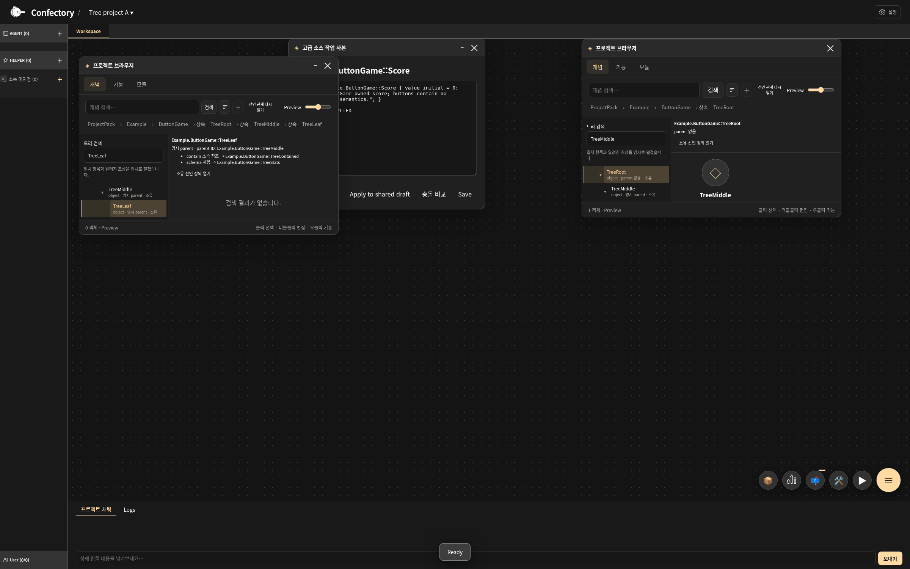
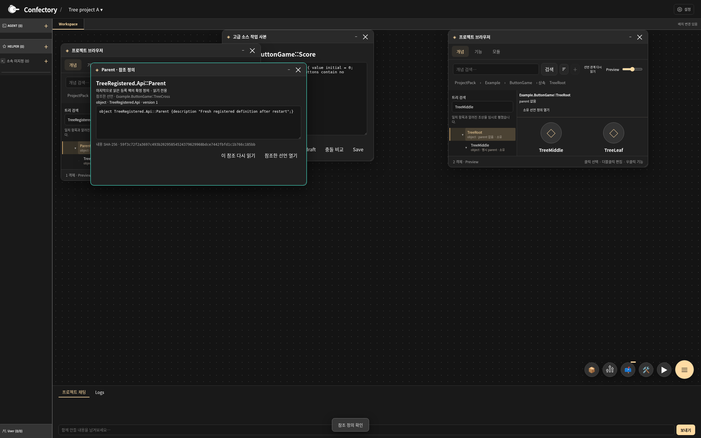

# IMP2: namespace와 명시 parent의 다단계 브라우저 트리

소스 기준은 `c63d4ea0e2ff7582f89e7a7113d48db7eb9c441a`다. 기존 breadcrumb 탐색 위에 실제 펼침/접힘·검색·키보드 이동이 가능한 트리를 연결했다. 현재 WebUI 브라우저 범위의 구현이며 전체 v480 완료를 뜻하지 않는다. [기계 판독 결과](validation/v480-declaration-tree.json)와 [시도 기록](validation/v480-declaration-tree-attempts.log)에 최종 결과와 개발 중 실패를 함께 남겼다.

## 데이터와 읽기 경계

- ProjectPack 아래 namespace 경로를 표시하고, 확정된 선언 ID와 소유 선언에서 관측한 명시적 `parent`만 선언 계층에 연결한다. 중간 namespace 경로는 경로라고 표시하며 실제 등록 팩으로 가장하지 않는다.
- 소유/등록 선언을 구분한다. 등록 선언의 parent 본문은 자동으로 읽지 않으며 `관계 미조회`로 표시한다. 정의 열기는 기존 소유 직접 참조와 source ID/revision/hash 검사를 통과해야 한다. 직접 참조가 없는 등록 선언은 버튼을 비활성화하고 서버도 `NOT_DECLARED_REFERENCE`로 거부한다.
- `contain`과 schema 사용/필드 참조는 선택 상세에서 별도로 표시한다. 이 관계를 폴더 소속이나 parent로 바꾸지 않는다. prototype Category의 편집·소속 의미를 CELEM category/concept와 대응시키는 DEC1은 이번 범위 밖이다.
- 없는 parent ID를 가짜 선언으로 만들지 않는다. 미해결, 순환, 다른 탭 경계, 잘못된 선언, 상위 관계 문제와 깊이 제한을 표시한다. 순환 자체의 간선은 끊되 알려진 자식의 즉시 parent는 보존한다. 관계는 최대 64개 조상을 검사하고 한 번에 최대 2048행을 표시한다. 한도 안내와 검색을 제공하며 무제한 깊이/크기 지원을 주장하지 않는다.
- 관계 투영은 관측된 구문 정보다. compiler가 해당 선언 집합을 유효하다고 승인했다는 뜻은 아니다.

## 상호작용과 수명

각 독립 브라우저 창이 펼침 ID, 선택 ID, 트리 검색어를 갖는다. 검색은 알려진 조상 경로를 임시로 펼치며 검색을 지우면 저장한 펼침 상태를 사용한다. 방향키와 Home/End로 보이는 행을 이동한다. 선택 상세와 정의 열기는 목록 상단에 있고 긴 트리 행은 따로 스크롤한다.

트리 선택은 보기 상태만 바꾼다. 정의 열기는 기존 명시적 동작을 거친다. 창 복제·프로젝트 A/B/A 전환에서 미적용 소스 입력과 살아 있는 입력 DOM을 보존한다. private 저장에는 ID와 보기 상태만 기록하며 관계 스냅샷은 저장하지 않는다. 실제 프로세스 재시작 뒤 inventory와 관계를 다시 읽고, 외부에서 바뀐 parent·새 선언·등록 정의를 반영한다. 사라진 선택 ID는 자동으로 다른 선언에 치환하지 않는다.

## 최종 검증

Linux의 실제 Chromium WebUI 및 관련 모델/투영 검사 **서로 다른 6개가 통과, 실패 0, 건너뜀 0**이다. 4 CPU, 메모리 한도 16 GiB에서 gate는 최대 2개였다. 앞선 통합 235개나 IMP1 결과에 합산하지 않는다.

| 검사 그룹 | 메서드 수 | 결과 | 시간 |
|---|---:|---|---:|
| 다단계 트리·기존 Home/문서 탐색·투영 | 3 | 모두 통과 | 41.984초 |
| 등록 직접 참조 gate·기존 hierarchy/Variation/fill/Confirm/cold | 2 | 모두 통과 | 81.631초 |
| 커밋 HEAD의 일반 Git 체크아웃·실제 리소스 시작 | 1 | 통과 | 6.665초 |

새 트리 시나리오는 3단계 parent, namespace와 교차 팩 parent, contain/schema 분리, 순환/미해결과 그 자식, 깊이 64/65 경계, 직접 참조 거부와 stale hash, 창별 상태, 두 프로젝트의 같은 ID 격리, 정확한 미적용 입력 DOM, 실제 재시작 후 최신 데이터를 검사했다. 의도적으로 읽을 수 없는 비참조 등록 원본은 끝까지 생성/조회하지 않는다. restart fixture의 명시적 외부 수정 외에 소유 소스가 바뀌지 않고 AI/Worker가 시작되지 않음을 확인했다.

체크아웃 검사는 실제 Git clone/checkout/fast-forward pull을 사용한다. 유지된 CRLF와 새 LF 체크아웃에서 **42개 리소스**를 실제 호스트로 읽어 identity를 비교하고, 내용·인코딩·BOM·binary·budget 변조를 거부하며 원본 바이트를 보존했다. Linux에서 Git 줄 끝 정책을 검사한 결과이며 Windows UI 실행 결과가 아니다.

## 시도 기록과 남은 범위

개발 중 초기 빈 inventory의 펼침 상태를 너무 일찍 저장한 문제를 고쳤다. 기존 테스트는 접힌 계층의 Score를 새 트리 검색으로 실제 표시한 뒤 선택하도록 바꿨다. 참조 미허용 응답은 transport 실패 대신 `unavailable/NOT_DECLARED_REFERENCE`라는 도메인 결과와 본문 부재를 확인하며, stale hash의 실패 검사는 유지한다. textarea의 최신 정의는 textContent 대신 정확한 live value로 검사한다.

한 번은 검사가 실행 중인 리소스를 편집해 canonical 크기가 달라졌고 리소스 guard가 정상 거부했다. 이후 소스와 pin을 고정한 상태로 최종 검사를 실행했다. timeout이나 gate 검증을 완화하지 않았다. 공개 텍스트 로그의 줄 끝 공백만 정리했으며 원본 scratch 로그는 보존했다.

native raw 소스 탐색기에 동일한 트리를 구현하거나 Windows native UI·Android 기기·browser-wasm에서 실행한 결과는 이 근거에 포함하지 않는다. native 대응 구현은 남은 구현 목록에, 실제 장치 검증은 기존 ENV 항목에 구분한다. DEC1 분류 의미, DEC2 소스 삭제/치환, DEC4 overflow, 기존 ENV4 불확실성도 유지한다. main·원본 ZIP 4개·Android 설정·CSP·binary 리소스는 보존했다. 새 계정/유료 AI/설치/권한 확장은 없다.

후속 [native 대응 트리](V480_NATIVE_DECLARATION_TREE.md)는 별도 소스·검증 기준으로 구현했다. 위 native 미구현 설명은 이 문서의 WebUI 기준 소스에 대한 범위 설명이며 현재 남은 구현 판정은 최신 상태 지도와 단일 목록을 따른다.
