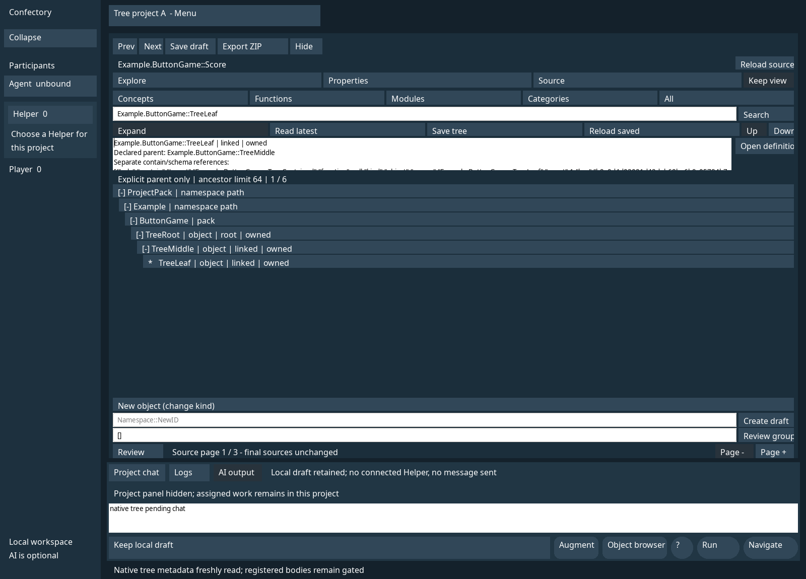
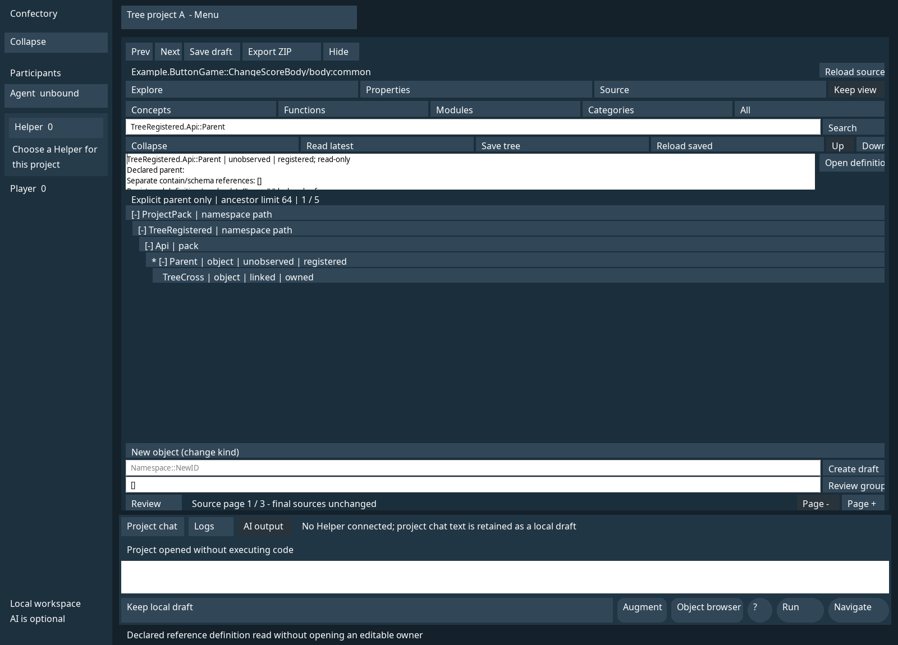

# IMP2: native 명시 선언 트리

소스 기준은 `63b96b58d5b9ffa63b3b2c1c519b00fa89011671`다. 최종 결과는 [기계 판독 근거](validation/v480-native-declaration-tree.json), 개발 중 실패와 재검사는 [시도 기록](validation/v480-native-declaration-tree-attempts.log)을 따른다. [WebUI 트리 계약](V480_DECLARATION_TREE.md)의 확정 inventory와 versioned owned relations map을 같은 조회 경계로 사용한다. 기존 Categories 탭은 category 선언 종류의 필터이며 새 분류 편집이나 소속 기능이 아니다. 두 투영의 parent·상태·직접 참조 source를 공유 fixture로 비교하며 Category 의미나 membership을 추가하지 않는다. 전체 v480 완료를 뜻하지 않는다.

## 표시와 읽기 경계

native Explore에 namespace 경로와 명시적 parent의 펼침·접힘, 검색, 선택 상세, 페이지 이동을 연결한다. 기존 16개 행 버튼과 컨트롤 ID를 재사용하고 새 컨트롤 owner를 만들지 않는다. 기존 shell 컨트롤 128개와 native field 한도 128을 늘리지 않았다. 선택 상세는 기존 208번 입력 자리를 읽기 전용 다중행 native 위젯으로 사용한다.

- namespace 중간 경로와 실제 pack을 구분한다. 소유/등록 선언을 표시하며, 선언을 계층에 연결하는 근거는 명시적 parent뿐이다.
- 미해결·순환·다른 탭 경계·잘못된 선언과 그 상위 문제를 별도로 표시한다. 없는 parent를 가짜 노드로 만들지 않는다. 등록 선언의 parent는 자동으로 본문을 읽지 않고 unobserved로 표시한다.
- ancestor 검사는 64개, 전체 표시 투영은 2048행이다. native 화면은 최대 16행의 버튼을 재사용하며 페이지로 이동한다. 깊이 제한·표시 제한을 안내하고 검색으로 범위를 좁힌다. 256자 초과 검색 입력은 보존하고 Search/Read/Save를 거부하며 현재 트리와 저장본을 유지한다. 검색 중 알려진 조상은 임시로 펼치며 검색을 지우면 수동 펼침 상태를 사용한다.
- contain과 schema 사용/필드 관계는 상세의 별도 참조다. 폴더나 Category membership으로 치환하지 않는다. 이 트리는 관측된 선언 구문이며 compiler 유효성 승인이나 새 실행 권한이 아니다.
- 트리 행 선택은 소스 선택과 분리한다. Open definition을 명시적으로 누른 경우에만 소유 선언을 열거나 기존 등록 정의 gate를 호출한다. 등록 정의는 소유 직접 참조 source ID/revision/hash가 필요하며 본문은 읽기 전용이다. 비참조 등록 항목의 열기는 비활성화한다.

## 입력과 명시 저장 수명

live 상태는 프로젝트 context로 격리하고 metadata 역시 해당 context와 project ID가 일치할 때만 사용한다. source/chat 버퍼는 원래 소유 키와 binding을 유지한다. Review가 열리면 공유 208번 컨트롤은 기존 Review 입력 동작을 사용한다. 트리 검색·선택·펼침·조회·저장과 프로젝트 A/B/A 왕복은 pending source를 Apply/Save하거나 chat을 전송하지 않는다. 다른 소유 정의를 명시적으로 열어도 원래 미적용 입력 버퍼는 보관한다.

Save tree는 `native-trees`의 프로젝트별 private JSON에 보기 상태만 명시 저장한다. version/projectId/expanded/selection/query/queryInput/group/offset의 여덟 필드만 허용한다. ID·검색어·행 offset·확장 수와 256 KiB 바이트 한도를 검사한다. 저장은 기존 FileStream Commit의 hash CAS를 사용한다. 조회로 편집 기준 hash를 자동 갱신하지 않고 명시 저장 성공 또는 Reload saved로만 갱신한다. 충돌·손상 시 저장본과 현재 입력을 보존한다. 저장 경로의 symlink는 읽기/쓰기 전에 거부한다. 손상/읽기 실패는 unavailable이고 Save를 비활성화한다.

Read latest는 현재 보기 상태를 유지하며 inventory와 owned relation map을 다시 조회한다. Reload saved는 저장된 보기 상태를 명시적으로 불러온다. 저장본에는 관계/본문 스냅샷, source/chat 내용, context handle을 넣지 않는다. 새 프로세스는 명시 저장한 보기 상태를 불러오고 실제 관계·정의를 새로 조회한다. 사라진 선택 ID는 missing으로 표시하며 다른 항목을 임의 선택하지 않는다.

**미저장 native source/chat의 process-cold 복원은 이 변경의 지원 주장이 아니다.** 살아 있는 context의 입력·binding 보존과 트리의 명시 저장본 복원을 구분한다. Windows 실제 UI·Android 기기/APK·WASM 실행도 별도 미검증 상태다.

## 검증과 보존

최종 서로 다른 **8개 메서드가 통과, 실패 0, 건너뜀 0**이다. Native 그룹 3개 349.845초, 계약/관리 컴파일 그룹 5개 223.677초이며 4 CPU/16 GiB에서 gate는 최대 2개였다. 이전 통합 235개나 WebUI/IMP1 검사 수에 합산하지 않는다. 정확한 메서드·소스 hash·실패 시도는 JSON과 로그에 고정한다. Linux는 task 소유 Xorg dummy의 실제 GTK3/GtkSourceView 입력, native 읽기 전용 속성, 검색·선택·펼침·페이지, 재진입과 프로젝트 전환, CAS/손상, WM close 및 새 프로세스의 최신 parent·등록 정의를 검사한다. 기존 native 정보/31개 프로필과 작은/zero-client resize 회귀를 함께 검사한다. 관리 컴파일은 Windows native 구성과 Android export의 managed 산출물을 검사하며 실제 OS/기기 성공으로 합산하지 않는다. 기존 WebUI 트리·등록 direct reference gate도 관련 회귀에 포함한다.

main·원본 ZIP 네 개·Android 설정·CSP·42개 WebUI resource pin과 binary를 보존한다. 실제 계정·유료/외부 AI 호출·설치·권한 확대·소스 삭제/치환·새 Category 의미·overflow 정책 변경은 없다. 기존 ENV4 재발 시 계측 한계도 유지한다. 현재 남은 범위는 [단일 우선순위 목록](V480_REMAINING_WORK.md)을 따른다.

