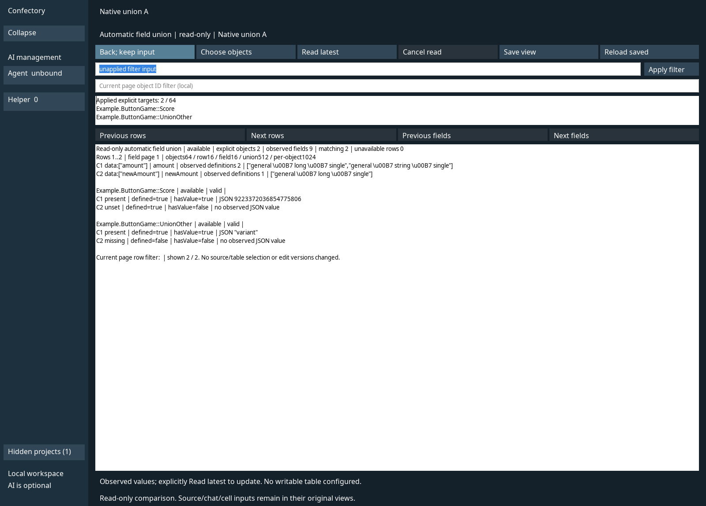
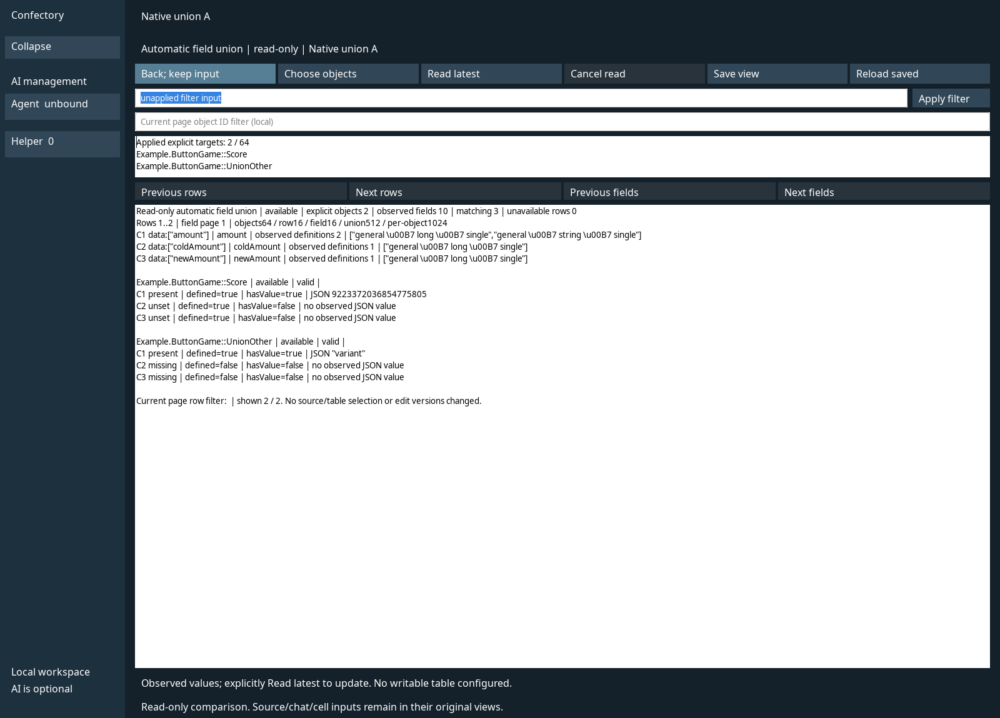

# IMP3: native 읽기 전용 자동 필드 합집합

[WebUI 합집합](V480_AUTOMATIC_FIELD_UNION.md)과 같은 `FieldDiscovery` 함수를 native 프로젝트의 **Field union** 버튼에서 호출한다. 계산 열·산술·overflow·null 쓰기 의미를 추가하지 않는다. 전체 v480 완료를 뜻하지 않는다. 소스 커밋, 정확한 최종 메서드와 시도 결과는 [기계 판독 근거](validation/v480-native-field-union.json)와 [실행 로그](validation/v480-native-field-union-attempts.log)를 따른다.

## 대상·페이지·정확한 값

첫 진입은 빈 명시 대상 목록이다. 소유 객체 목록에서 후보를 토글한 뒤 **Apply selection**을 눌러야 필드를 읽는다. 후보 변경 취소는 적용한 대상을 그대로 유지한다. 저장된 명시 대상이 있으면 그 대상만 새로 조회한다. 목록/필드 표시와 기존 source 선택·쓰기 표 정의를 분리하며, 자동으로 쓰기 table을 열거나 객체·열 선택을 넓히지 않는다. 외부 팩의 객체는 선택 목록과 조회에서 제외하고 기존에 허용된 스키마 메타데이터 접근만 재사용한다.

목록은 공통 서비스의 64개 페이지를 사용하고 native에는 최대 16개 버튼을 표시한다. 작은 창에서 표시 행이 줄면 그 실제 행 수만큼 다음으로 이동하므로 객체를 건너뛰지 않는다. 합집합은 공통 서비스의 16행·16열 페이지로 이동한다. 필드 필터는 명시 적용하고 현재 페이지의 객체 ID 필터는 로컬 표시만 바꾼다. 필터 초과 입력은 그대로 보존하며 Read/Apply/Save를 거부한다. 화면을 닫았다 열어도 live 필터 입력을 바꾸지 않는다.

native 결과는 선택·복사가 가능한 읽기 전용 GTK/GtkSourceView 텍스트다. C1…C16 범례에 필드 ID·타입 관측·정의 수를 한 번 표시하고 객체별 관측을 그 번호로 연결한다. 서버의 `valueJson`을 숫자로 다시 파싱하지 않는다.

| 표시 | 의미 |
|---|---|
| `missing`, defined=false | 관측 완료한 객체에 해당 정의 없음 |
| `unset`, defined=true, hasValue=false | 선언됐지만 값이 설정되지 않음 |
| `default` | 기존 description 조회 API의 기본 빈 문자열 |
| `present`, JSON null | 실제 null 조회 응답 |
| JSON 0·false·"" | 실제 명시 값 |
| `row-unavailable`, defined=unknown | 해당 객체의 메타데이터 조회 실패 |
| `unobserved-limit`, defined=unknown | 객체 필드 한도로 관측하지 못함 |
| `value-limit`, hasValue=true | 값이 있으나 공통 값 표시 한도 초과 |

실패/미관측을 누락이나 null로 바꾸지 않는다. 공통 서비스의 객체 64·ID 512자·필터 256자·객체 필드 1024·일치 합집합 512·기존 스키마 512행/깊이 64·타입 관측 네 종류·값 하나 64 KiB/페이지 값 합계 256 KiB/응답 1 MiB 한도를 유지한다. native 텍스트는 추가로 524288 UTF-16 문자, 타입 메타데이터 한 항목은 4096자로 제한한다. 생략은 native display limit으로 명시하며 실제 값 상태를 누락으로 고치지 않는다. 더 좁은 필터와 명시 재조회로 범위를 줄인다.

**CELEM의 메타데이터 null 리터럴과 새 null 쓰기는 지원하지 않는다.** 실제 null 응답의 표시 검사는 정상 scalar 원본을 보존한 소유 `DescribeSchema` 복사본의 읽기 adapter로 수행한다. 원래 parser·ABI·writer와 제품 `FieldDiscovery`에는 test switch가 없다.

## 작업·입력·위젯 수명

조회는 기존 HostLoop의 소유 작업으로 실행한다. 공통 cancellation token의 callback은 작업 시작 전에 등록하고 완료 finally에서 제거한다. Cancel read는 원자적으로 취소를 요청하며 현재 메타데이터 호출 후/다음 읽기 전에 협력적으로 멈춘다. 새 필터·대상·페이지 조회는 이전 작업을 취소하고 마지막 명시 요청만 이어서 실행한다. 자동 데이터 재시도는 하지 않는다.

완료 시 context/project/generation과 대상·적용 필터·페이지가 일치할 때만 결과를 화면에 보관한다. 편집 모델의 snapshot이나 작업 표에 결과를 게시하지 않는다. 같은 범위의 재조회 취소/실패는 이전 관측임을 알리고, 범위가 달라지면 이전 표를 표시하지 않는다. 공유 작업 사본의 revision/hash와 조회되는 확정 schema view의 도중 변경 거부는 공통 `FieldDiscovery`가 수행한다. 열려 있는 소유 작업 사본을 외부 확정 파일로 자동 교체하지 않는다.

Back 중 읽기는 취소·완료를 확인한 뒤 원래 프로젝트 화면으로 돌아간다. 비교 위젯은 전용 binding이며 source/chat/property-cell binding을 공유하거나 적용하지 않는다. 닫는 비교 위젯은 forget으로 폐기하고 live 텍스트 버퍼는 context 소유로 유지한다. 프로젝트를 닫으면 해당 버퍼와 보기 상태도 함께 해제한다. 기존 shell 128개 컨트롤·detail owner·native 필드 128 한도를 늘리지 않았다. 프로젝트의 미사용 82번 버튼과 기존 detail/선택 버튼 슬롯을 재사용한다.

기존 native source/property 쓰기는 원래 revision CAS를 사용한다. 비교 응답의 textHash/viewHash를 그 편집 기준으로 옮기지 않는다. 기존 InstantTable의 명시 대상·열과 source/schema version 계약도 바꾸지 않는다.

native WM close는 읽기를 취소하고 작업이 끝나기 전 세션을 해제하지 않는다. 늦은 결과를 새 화면에 그리지 않는다. 기존 retained property cell·source·chat의 내용/binding과 편집 기준 revision/hash를 유지한다. 새 조회가 원래 쓰기 CAS를 갱신하지 않으므로 다른 writer가 공유 작업 사본을 바꾼 뒤 오래된 셀 적용은 기존 편집 계약에서 거부한다. 프로젝트 A/B/A의 동일 객체 ID도 context와 project ID로 격리한다.

## 명시 저장과 cold

**Save view**는 `native-field-unions`의 프로젝트 ID hash 경로에 version/projectId/ids/query/queryInput/rowFilter/rowOffset/fieldPage의 여덟 필드만 저장한다. 적용 필터와 미적용 필터 입력을 구분한다. 결과·본문·context handle·source/chat/cell 입력·새 편집 버전은 넣지 않는다. 기존 FileStream hash CAS로 저장하며 Read latest는 저장 기준 hash를 갱신하지 않는다. 명시 Save 성공 또는 Reload saved만 기준 hash를 갱신한다. 충돌은 저장본과 현재 입력을 보존한다.

Reload saved에서 설정의 손상·읽기 실패를 발견하면 저장 불가로 표시하고 Save를 비활성화한다. 경로의 symlink를 읽기/저장 전에 거부하며 파일·상태 256 KiB와 ID/필터/페이지 한도를 검사한다. explicit Reload는 저장된 설정을 불러오고 실제 필드와 스키마를 새로 조회한다. 새 프로세스도 같은 방식으로 현재 원본을 읽으며 사라지거나 권한 범위를 벗어난 ID를 자동 대체하지 않는다.

**미저장 native source/chat/cell 입력의 process-cold 복원은 이 변경의 지원 주장이 아니다.** 기존 live context의 입력·편집 기준 보존과 명시 저장한 비교 설정의 cold 복원을 구분한다. 저장한 비교 설정으로 새 프로세스에서 현재 schema/value를 읽는 것을 검사한다.

제품 소스 기준은 `9084674bd9e8edce5818b91628f523648f96a698`, 최종 소유 fixture 기준은 `a53f1ab397a460391a5e9ab0b7ecc280aa211909`다. 이후 변경은 fixture와 문서이며 제품 소스는 동일하다. **최종 서로 다른 10개 메서드가 통과, 실패 0, 건너뜀 0**이다. format fixture 재확인은 추가 메서드로 세지 않았다. resize의 읽기 전용 기본 홈 시작 실패는 보존했고, 소유 XDG 경로에서 같은 검사 통과 후 메서드별 마지막 결과를 사용한다. 4 CPU/16 GiB에서 gate는 최대 2개였다. 일반 Git 체크아웃도 같은 제품 소스와 43개 리소스를 사용한다.

## 검증 경계

실제 Linux 검사는 task 소유 Xorg dummy의 GTK3/GtkSourceView 입력·읽기 전용 paste 거부, 작은 창의 객체 선택 페이지, 두 합집합 페이지 축, 로컬/적용 필터, 후보 취소, cooperative cancel과 늦은 응답, schema 도중 변경, 비교 닫기·재진입, settings CAS/손상, live source/chat/cell binding·원래 쓰기 버전, A/B/A, WM close 중 작업 정리, 새 프로세스의 최신 schema/value를 다룬다. 소유 fixture에서 확정 schema를 외부 변경하고, 경쟁 writer는 기존 `SetTextIfRevision`으로 같은 공유 작업 사본의 revision을 증가시킨다. cold 직전에 확정 값을 별도로 바꿔 이전 live 값과 다른 최신 값을 읽는지 검사한다. 취소 후 성공 결과를 늦게 반환하는 소유 reader도 별도로 사용하며 제품 reader의 취소 규칙은 그대로다.

모델/format fixture는 공통 실제 조회의 정확한 JSON·누락/미관측/실패와 byte/state 한도·private CAS·symlink를 검사한다. Windows는 native 관리 컴파일, Android는 기존 export의 managed 산출물만 검사한다. 실제 Windows UI·Android APK/기기·WASM 실행과 동일시하지 않는다. 기존 WebUI 합집합 및 43개 리소스의 일반 Git LF/잔존 CRLF 체크아웃·실제 시작도 관련 회귀로 분리한다. 이전 단계의 검사 수를 합산하지 않는다.

main·원본 ZIP 네 개·Android 설정·CSP·WebUI 리소스/기존 binary를 보존한다. 실계정·유료 호출·설치·권한 확대가 없다. 남은 계산 열·일반 선택 범위 확장은 [단일 목록](V480_REMAINING_WORK.md)에 유지한다.

